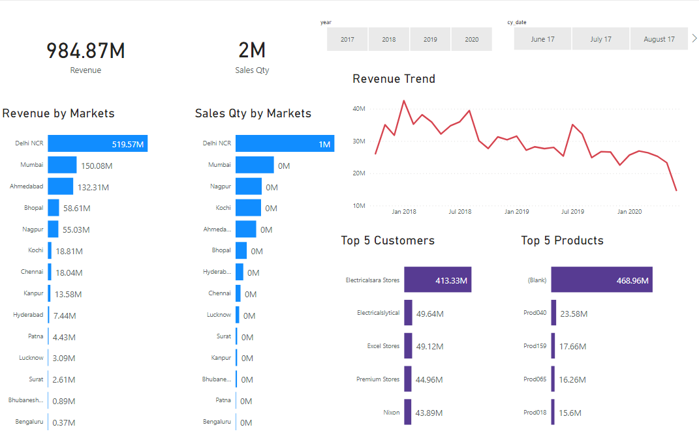

# Sales Insights Dashboard (Power BI)

An interactive Power BI dashboard that gives a hardware company's sales team a quick view of performance, built from the company's MySQL sales database.

## The problem
Sales data sat in a MySQL database. Getting answers such as "who are our biggest customers?" or "is revenue going up?" meant querying the database each time.

## What I built
- **ETL:** extracted the sales data from MySQL and cleaned it in Power Query.
- **Data model:** related the sales transactions to customers, products and dates.
- **Dashboard:** revenue, sales quantity and revenue trend, plus the top 5 customers and top 5 products, with filters for drilling in.

## Tools
Power BI · MySQL · SQL · Power Query

## Files
| File | What it is |
|---|---|
| `*.pbix` | The Power BI report (open in Power BI Desktop) |
| `dashboard.png` | Screenshot of the dashboard |

---
Portfolio: [nashkavirajan.wixsite.com/avinash-kavirajan](https://nashkavirajan.wixsite.com/avinash-kavirajan)
